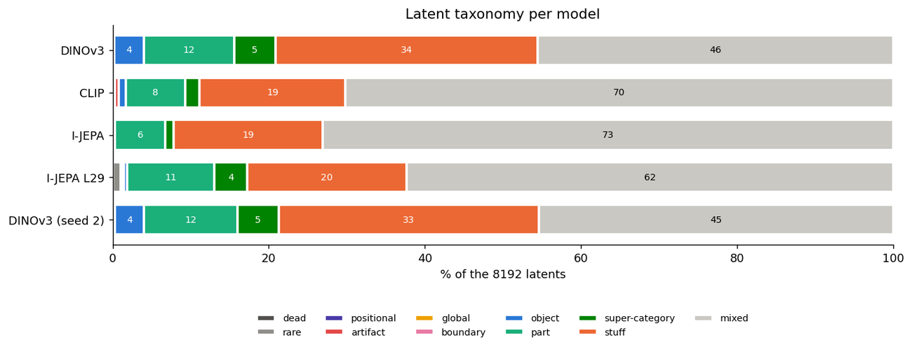
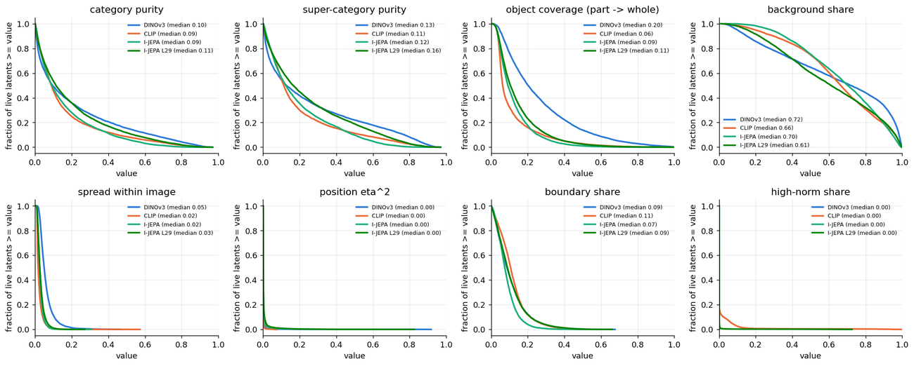
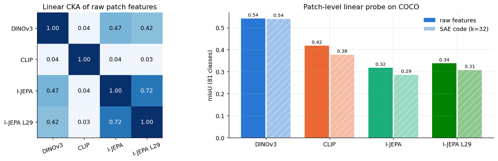
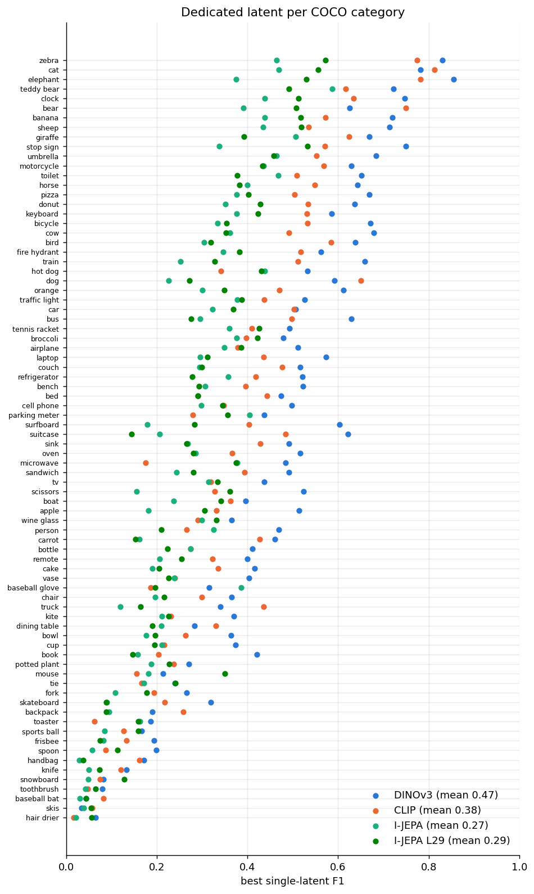
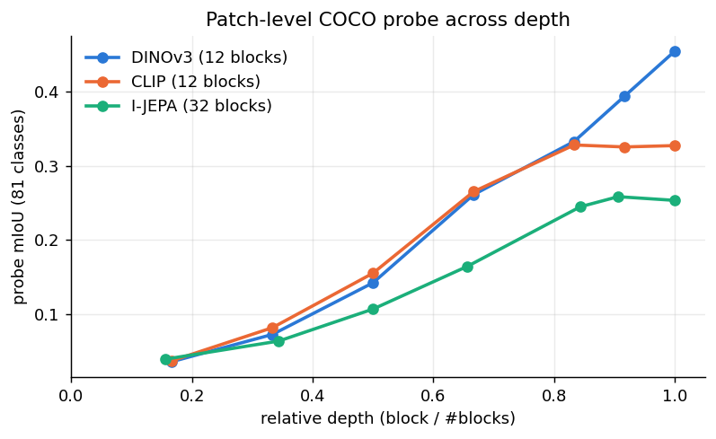
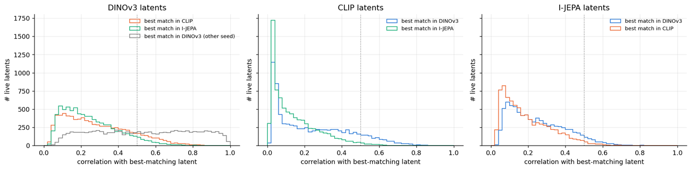
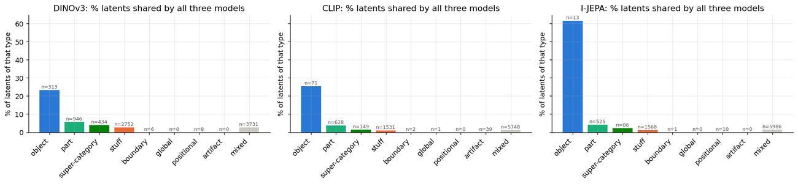
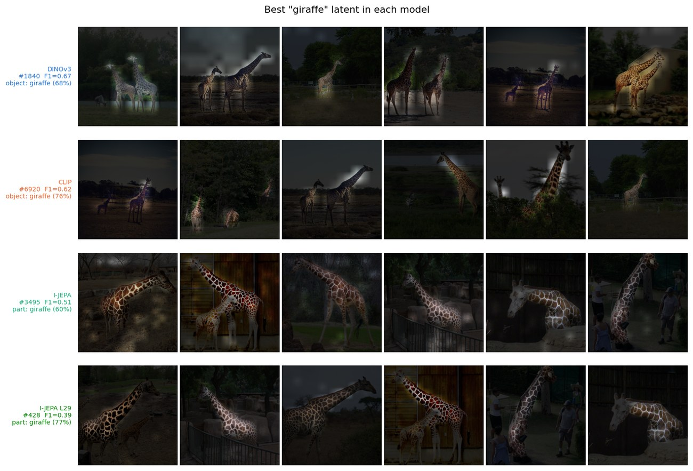
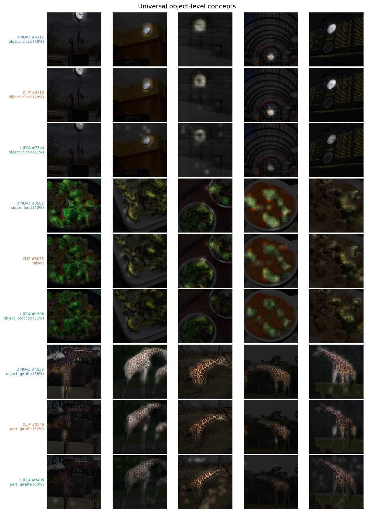
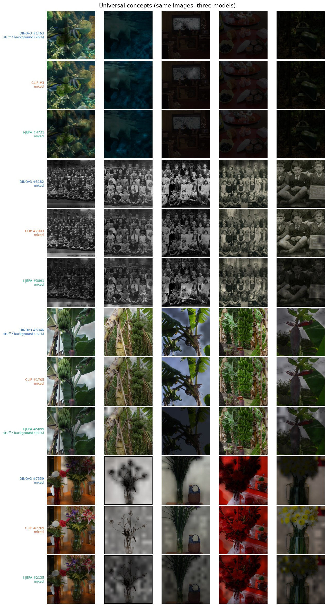

# What do DINOv3, CLIP and I-JEPA "see"?
### Sparse autoencoders on vision-transformer patch features, compared concept by concept

I trained one **TopK sparse autoencoder (SAE)** on the final-layer patch tokens of each of three vision
transformers, using the same dictionary size (8192 latents) and the same sparsity (32 active latents per patch).
I then used **COCO instance masks** to measure what each of the 3 × 8192 latents actually encodes. The notebook
runs end to end on a single free Kaggle T4 GPU in about 70 minutes.

| Model | Objective | Supervision |
|---|---|---|
| **DINOv3** ViT-B/16 | self-distillation (image + patch level) + Gram anchoring | images only |
| **CLIP** ViT-B/16 | contrastive image–text matching of the global embedding | captions |
| **I-JEPA** ViT-H/14 | predict latent features of masked regions from context | images only |

**Notebook:** [`sae_vision_concepts.ipynb`](sae_vision_concepts.ipynb) (executed on Kaggle, with all outputs)

---

## Key findings

| | DINOv3 | CLIP | I-JEPA | I-JEPA (block 29/32) |
|---|---:|---:|---:|---:|
| object-level latents (whole object + part + super-category) | **20.7%** | 10.4% | 7.6% | 15.8% |
| whole-object latents | **313** | 71 | 13 | 32 |
| COCO categories with a dedicated latent (F1 ≥ 0.5) | **38 / 80** | 23 / 80 | 2 / 80 | 8 / 80 |
| DINOv3 latents with a counterpart here (corr ≥ 0.5) | *54% (2nd seed)* | 14% | 6% | 12% |
| SAE val FVU | 0.221 | 0.110 | 0.193 | 0.233 |
| linear probe mIoU: raw → SAE code | 0.54 → 0.54 | 0.42 → 0.38 | 0.32 → 0.29 | 0.34 → 0.31 |

1. **DINOv3 has by far the most object-level dictionary.** It has about 2× the object-level latents of CLIP, 4× the
   whole-object latents, and a dedicated latent for almost half of the COCO categories. A second SAE with a different
   seed gives the same taxonomy.
2. **Does JEPA learn more object-level concepts than CLIP? At the final layer, no. At its best layer, it learns more
   object parts but fewer whole categories.** Final-layer I-JEPA has the least object-level dictionary, and its
   "category" latents are part/texture detectors: its best giraffe latent fires on the *coat pattern*, not the
   animal. A depth sweep shows that I-JEPA's patch features peak at block 29/32. An SAE there doubles the
   object-level share to 15.8% (above CLIP), mostly as **part** latents, but still has far fewer clean category
   detectors than CLIP. In short: I-JEPA is part-level, CLIP is category-level (captions name whole objects),
   and DINOv3 has both.
3. **Shared concepts are the exception, and DINOv3 is the hub.** Two SAEs on the *same* DINOv3 features match on
   54% of latents. Across models the figure drops to 14% (DINOv3→CLIP), 6% (DINOv3→I-JEPA) and 2% (CLIP→I-JEPA),
   and only 2–4% of latents are shared by all three models.
4. **What is shared is objects and textures.** Whole-object latents are the most universal type: about a quarter of
   DINOv3's and CLIP's (and 8 of I-JEPA's 13) are shared by all three models, against under 6% for every other type.
   Clocks, teddy bears and tennis rackets are whole-object latents in all three models; for giraffes and laptops,
   CLIP and I-JEPA match with a *part*-level latent instead. The single strongest triplets are texture/scene concepts
   (underwater scenes, crowds of faces, foliage).
5. **CLIP's final-layer patch tokens are peculiar.** 3.6% of them form a high-norm mode (3–6× the median norm), and
   39 SAE latents specialise on these register-like tokens. CLIP also has the lowest SAE FVU, and its linear CKA to
   the other models is ≈ 0.04 even though many concepts match at the latent level.
6. **The SAEs keep the semantics.** A probe on the 32-sparse code recovers about 90–100% of the raw-feature probe
   mIoU (DINOv3 99.6%, CLIP 90.3%, I-JEPA 89.9%).

---

## Method

**Data.** SAEs are trained on 3.2M patch tokens: 128 random patches from each of 25k COCO `train2017` images.
All analysis uses 5k held-out `val2017` images (about 1M patches per model). The instance masks go through the
same resize and crop as the images and are averaged into each model's patch grid, so every patch gets a
category (80 things + background), an instance id and a boundary flag.

**SAE.** TopK SAE ([Gao et al., 2024](https://arxiv.org/abs/2406.04093)), 8192 latents, k = 32, unit-norm decoder,
AuxK loss for dead latents, 12k steps of batch 4096 with Adam. Features are centred and scaled so that
E‖x‖² = d. There are no dead latents in any model.

**What each latent encodes.** Every quantity is measured over val patches and weighted by activation:

| metric | meaning |
|---|---|
| purity | share of the latent's activation on its single best COCO category |
| coverage | on objects of that category where the latent fires, the fraction of the object's patches it covers (**part** → low, **whole object** → high) |
| background share | share on patches outside every object mask (sky, road, wall, …: "stuff") |
| super-purity | purity at the level of COCO super-categories (animal, vehicle, food, …) |
| boundary / high-norm share, position η², spread | edge detectors, register-like artifact tokens, positional latents, image-global latents |

These metrics are combined into a rule-based **taxonomy** (object, part, super-category, stuff, boundary, positional,
global, artifact, mixed). The notebook also plots the full distribution of every metric, so the conclusions do not
hinge on the thresholds.

**Which concepts are shared.** Latent activations of all models are placed on a common 14×14 grid (I-JEPA's
16×16 grid is area-resampled), and the Pearson correlation is computed for **all 8192 × 8192 latent pairs** of
each model pair. Each latent's best match in another model says whether that model has the "same" concept.
A **seed control** (a second SAE on DINOv3 with a different seed) calibrates the scale of these correlations.

**Controls and context.** The notebook includes a patch-level linear probe (81-way) on raw features and on
SAE codes, linear CKA between raw features, a **depth sweep** of the probe at 7 depths per model, and a fourth SAE
on **I-JEPA's best intermediate layer**.

## Figures

| | |
|---|---|
|  |  |
|  |  |
|  |  |

**The same category in each dictionary**. The image is dimmed except where the latent fires:

**Object concepts shared by all three models** (rows: DINOv3 / CLIP / I-JEPA on the same images):

**The most universal concepts overall** are texture- and scene-like:

**Concepts unique to one model:** [DINOv3](figures/unique_DINOv3.jpg) · [CLIP](figures/unique_CLIP.jpg) ·
[I-JEPA](figures/unique_I-JEPA.jpg). **Per-model tours:** [DINOv3](figures/tour_DINOv3.jpg) ·
[CLIP](figures/tour_CLIP.jpg) · [I-JEPA](figures/tour_I-JEPA.jpg) · [I-JEPA block 29](figures/tour_I-JEPA_L29.jpg). **SAE segmentation:** [sae_segmentation.jpg](figures/sae_segmentation.jpg)

**More:** best latent per model for [person](figures/category_person.jpg), [pizza](figures/category_pizza.jpg) and
[train](figures/category_train.jpg) · [more shared object concepts](figures/universal_objects_2.jpg) ·
[more shared triplets](figures/universal_triplets_2.jpg) · [how COCO masks become patch labels](figures/patch_labels.jpg) ·
[SAE training curves](figures/sae_training.jpg) · [patch-token norm distribution](figures/token_norms.png)

## Caveats

- **Final LayerNorm.** The final outputs of DINOv3 and I-JEPA pass through a LayerNorm, which evens out token norms; CLIP's `last_hidden_state` does not. So the "CLIP-only" high-norm tokens are partly a consequence of where the features are read out. I-JEPA's block 29, read before the final norm, shows a small high-norm mode (0.26%).
- **Model sizes differ.** I-JEPA is only public as ViT-H/14 (632M parameters, 1280-d, trained on ImageNet-1k).
  DINOv3 and CLIP are ViT-B/16 (86M parameters, 768-d, trained on far larger datasets). The dictionary size is fixed
  at 8192, so the I-JEPA SAE has a smaller expansion factor (6.4× vs 10.7×).
- **COCO labels only cover 80 "thing" classes.** Many real objects (walls, shelves, trees, …) count as
  "background", so the stuff/mixed split is conservative about what counts as an object.
- **"Mixed" is not "meaningless".** Mixed latents are those that the COCO labels cannot explain: textures,
  materials, lighting, sub-parts of unlabelled objects.
- **I-JEPA's patch grid is resampled** (16×16 → 14×14) for the cross-model correlations, which slightly
  lowers its correlations. The depth sweep and the per-model taxonomies do not rely on resampling.
- There is one SAE seed per model, plus the seed control for DINOv3. The two DINOv3 seeds give nearly identical
  taxonomies (see the taxonomy figure), so the between-model differences are much larger than the seed noise.

## Run it yourself

**Everything reproduces in ~70 min on a single free Kaggle T4.** On Kaggle: create a notebook, add the dataset
`awsaf49/coco-2017-dataset`, enable a GPU (T4) and internet, and run
[`sae_vision_concepts.ipynb`](sae_vision_concepts.ipynb). All knobs are in the first code cell. `SMOKE = True`
runs a 4-minute version on 200 images that exercises every code path.

[`sae_vision_concepts.py`](sae_vision_concepts.py) is the same notebook in [jupytext](https://jupytext.readthedocs.io)
percent format, for readable diffs.

## References

- Gao et al., *Scaling and evaluating sparse autoencoders* (2024)
- Siméoni et al., *DINOv3* (2025) · Radford et al., *CLIP* (2021) · Assran et al., *I-JEPA* (2023)
- Darcet et al., *Vision Transformers Need Registers* (2024)
- Bricken et al., *Towards Monosemanticity* (2023)
